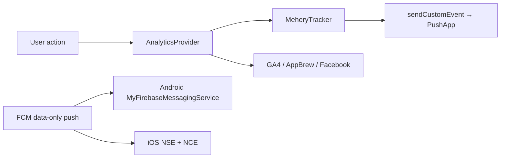

> **Superseded:** the current integration guide is [`vendor/react-native-pushapp-appbrew/README.md`](../vendor/react-native-pushapp-appbrew/README.md). This file is kept for history and may be out of date.

# Mehery SDK Integration

**App Brew host:** Natori (`com.app.appbrew`)  
**SDK:** `react-native-pushapp-appbrew` `0.0.50`  
**Install path:** `file:./vendor/react-native-pushapp-appbrew`  
**Date:** 31 August 2026

This is the one-page recipe for how PushApp sits inside App Brew **without touching product screens or `@gauntlet/*` call sites**. Copy a snippet, paste it, keep going.

---

## What “seamless” means

App Brew already owns analytics, Shopify, and Firebase Push. Mehery is a **side layer**:

1. **Boot once** on cold start (`startMehery` after App mount).
2. **Dual-send** every ecom event through `MeheryTracker` on `AnalyticsProvider`.
3. **Own the rich notification tray** (Android native FCM service + iOS NSE/NCE) while App Brew still uses `modules['push'] = FirebasePush`.



You never patch `add_to_cart` call sites. The tracker fans events out.

---

## 1. Install the package

```json
{
  "dependencies": {
    "react-native-pushapp-appbrew": "file:./vendor/react-native-pushapp-appbrew",
    "react-native-push-notification": "^8.1.1",
    "@react-native-async-storage/async-storage": "^3.1.1",
    "@react-native-firebase/app": "23.3.1",
    "@react-native-firebase/messaging": "23.3.1"
  }
}
```

```bash
pnpm install
pnpm pod-install
```

Confirm CocoaPods lists `MeheryEventSender`. Firebase `google-services` stays as it already is:

```gradle
// android/build.gradle
classpath("com.google.gms:google-services:4.4.3")

// android/app/build.gradle
apply plugin: "com.google.gms.google-services"
```

---

## 2. Android folder

Mehery’s `MyFirebaseMessagingService` is **merged from the SDK AAR**. The host only does two things: credentials, and getting React Native Firebase out of the way.

### 2.1 Manifest — `android/app/src/main/AndroidManifest.xml`

Need `xmlns:tools` on `<manifest>`. Then:

```xml
<uses-permission android:name="android.permission.WAKE_LOCK" />
<uses-permission android:name="android.permission.POST_NOTIFICATIONS" />

<application ...>
  <!-- Mehery owns background rich FCM. Remove RNFB's no-op service. -->
  <service
    android:name="io.invertase.firebase.messaging.ReactNativeFirebaseMessagingService"
    android:exported="false"
    tools:node="remove" />
  <!-- existing MainActivity, Firebase channel meta-data stay as-is -->
</application>
```

**Why:** if both services remain, data-only carousel / BigPicture / live-tray pushes never reach Mehery.

### 2.2 Credentials — `android/app/src/main/res/values/strings.xml`

```xml
<string name="mehery_prod_app_id" translatable="false">pa_YOUR_APP_ID</string>
<string name="mehery_prod_app_key" translatable="false">pas_YOUR_APP_KEY</string>
<string name="mehery_sandbox_app_id" translatable="false">pa_YOUR_APP_ID</string>
<string name="mehery_sandbox_app_key" translatable="false">pas_YOUR_APP_KEY</string>
<string name="mehery_dev_app_id" translatable="false">pa_YOUR_APP_ID</string>
<string name="mehery_dev_app_key" translatable="false">pas_YOUR_APP_KEY</string>
```

`readCredentialsForEnvironment()` reads these native strings. Rotating keys needs a store update.

### 2.3 Android push types (no extra host code)

| Type | Payload keys |
|------|----------------|
| Simple banner | `title`, `body` |
| BigPicture | `image` / `imageUrl` / `image_url` |
| Carousel (Prev/Next, max 4) | `imageUrls` or `image1`…`imageN` |
| Live tray | `message1` + `message2` + `message3` |
| CTA buttons | `title1`/`url1`/`action1` or `cta_buttons` |
| Deep link | `notification_url` |

**Rule:** background rich UI needs a **data-only**, high-priority FCM. A top-level `notification` block shows the stock OS tray and skips Mehery.

```json
{
  "title": "New arrivals",
  "body": "Swipe looks",
  "imageUrls": "[\"https://example.com/1.jpg\",\"https://example.com/2.jpg\"]",
  "notification_url": "https://shop.example/collections/all",
  "title1": "Shop",
  "url1": "https://shop.example/collections/all",
  "action1": "SHOP"
}
```

Verify:

```bash
adb logcat -s MyFirebaseMessagingService:I
```

---

## 3. iOS folder

Three extra targets ride inside `ios/natori.xcodeproj`, plus credentials and categories on the main app.

| Folder / target | Bundle id | Job |
|-----------------|-----------|-----|
| `ios/natori/` | `com.app.appbrew` | Credentials, categories, APNs, Live Activity start |
| `ios/ImageNotification/` | NSE | Download images for rich banners |
| `ios/ImagePreviewExtension/` | `com.app.appbrew.ImagePreviewExtension` | Carousel / action UI |
| `ios/DeliveryActivity/` | `com.app.appbrew.DeliveryActivity` | Lock Screen / Dynamic Island |

### 3.1 Credentials + background — `ios/natori/Info.plist`

```xml
<key>MeheryProdAppId</key>
<string>pa_YOUR_APP_ID</string>
<key>MeheryProdAppKey</key>
<string>pas_YOUR_APP_KEY</string>
<key>MeherySandboxAppId</key>
<string>pa_YOUR_APP_ID</string>
<key>MeherySandboxAppKey</key>
<string>pas_YOUR_APP_KEY</string>
<key>MeheryDevAppId</key>
<string>pa_YOUR_APP_ID</string>
<key>MeheryDevAppKey</key>
<string>pas_YOUR_APP_KEY</string>

<key>UIBackgroundModes</key>
<array>
  <string>remote-notification</string>
  <string>fetch</string>
</array>

<key>NSSupportsLiveActivities</key>
<true/>
<key>NSSupportsLiveActivitiesFrequentUpdates</key>
<true/>
```

### 3.2 Entitlements — `ios/natori/natori.entitlements`

```xml
<key>aps-environment</key>
<string>production</string>
<key>com.apple.security.application-groups</key>
<array>
  <string>group.com.app.appbrew.NotificationLiveActivity</string>
</array>
```

Enable the same App Group on `DeliveryActivityExtension`.

### 3.3 AppDelegate — `ios/natori/AppDelegate.swift`

On launch: Firebase, notification delegate, categories, APNs.

```swift
FirebaseApp.configure()
Messaging.messaging().delegate = self
UNUserNotificationCenter.current().delegate = self
registerNotificationCategories()

UNUserNotificationCenter.current().requestAuthorization(options: [.alert, .sound, .badge]) { granted, _ in
  if granted {
    DispatchQueue.main.async { application.registerForRemoteNotifications() }
  }
}
```

Forward APNs to FCM **and** `RNCPushNotificationIOS`. Do **not** also send the FCM token through Mehery’s APNs `PushTokenEvent` (that corrupts the PushApp session id).

```swift
func application(_ application: UIApplication,
                 didRegisterForRemoteNotificationsWithDeviceToken deviceToken: Data) {
  Messaging.messaging().apnsToken = deviceToken
  PushTokenManager.sendTokenEvent("apns", token: /* hex */)
  RNCPushNotificationIOS.didRegisterForRemoteNotifications(withDeviceToken: deviceToken)
}
```

Register every PushApp category (carousel + all 2-button and 3-button sets). The NCE `Info.plist` must list the **same** ids:

`THREE_BUTTON_CATEGORY`, `THREE_CAROUSEL_CATEGORY`, `THREE_CONFIRMATION_CATEGORY`, `THREE_RESPONSE_CATEGORY`, `THREE_SUBSCRIPTION_CATEGORY`, `THREE_TRANSACTION_CATEGORY`, `THREE_CONTENT_CATEGORY`, `THREE_CHECKOUT_CATEGORY`, `THREE_FORM_ACTION_CATEGORY`, `THREE_DESTRUCTIVE_ACTION_CATEGORY`, `THREE_CONTACT_CATEGORY`, `CAROUSEL_CATEGORY`, `CONFIRMATION_CATEGORY`, `RESPONSE_CATEGORY`, `SUBSCRIPTION_CATEGORY`, `TRANSACTION_CATEGORY`, `CONTENT_CATEGORY`, `CHECKOUT_CATEGORY`, `FORM_ACTION_CATEGORY`, `DESTRUCTIVE_ACTION_CATEGORY`, `CONTACT_CATEGORY`.

Foreground presentation:

```swift
completionHandler([.banner, .list, .sound, .badge])
```

Tap handling opens `notification_url` / `notificationUrl` / `url` / `deeplink`.

Live Activity: `didReceiveRemoteNotification` starts/updates when the payload has `activity_id` (see `ios/natori/MeheryLiveActivity.swift`). Silent ping: `type: silent_daily_ping`.

### 3.4 Notification Service Extension — `ios/ImageNotification/`

| File | Role |
|------|------|
| `NotificationService.swift` | Mehery multi-image NSE (not Firebase `populateNotificationContent`) |
| `Info.plist` | `com.apple.usernotifications.service` + `NSAllowsArbitraryLoads` |

```xml
<key>NSExtensionPointIdentifier</key>
<string>com.apple.usernotifications.service</string>
<key>NSAppTransportSecurity</key>
<dict>
  <key>NSAllowsArbitraryLoads</key>
  <true/>
</dict>
```

### 3.5 Notification Content Extension — `ios/ImagePreviewExtension/`

Carousel / category UI. Principal class `NotificationViewController`. Categories in `Info.plist` must match AppDelegate.

### 3.6 Live Activity — `ios/DeliveryActivity/`

WidgetKit extension. Shared App Group for hero images. Signing: create the App ID + App Group in Apple Developer and assign profiles before release.

### 3.7 Podfile targets

```ruby
target 'natori' do
  # existing RN + Firebase pods
end

target 'ImageNotification' do
end

target 'ImagePreviewExtension' do
end

target 'DeliveryActivityExtension' do
end
```

The NSE does **not** depend on Firebase Messaging.

```bash
pnpm pod-install
```

---

## 4. JavaScript — the seamless layer

All host glue lives in `src/mehery/`. App Brew screens stay untouched.

### 4.1 Why not `index.js`

This app uses Re.Pack. Loading Mehery during `AppRegistry` evaluation stalls on circular modules. **Do not** `import` the SDK at the top of `index.js`. Register FCM from `startMehery` after App mount.

```js
// index.js — Mehery is NOT imported here
AppRegistry.registerComponent(appName, () => App)
```

### 4.2 Channel + environment

`src/mehery/channelPin.ts` / `bootstrap.ts`:

```ts
export const MEHERY_CHANNEL_ID = 'ecommerce_1786525308082' // tenant_channel from dashboard
export const MEHERY_ENVIRONMENT = false // production → pushapp.ai
```

| `initSdk` env | Host | Native keys |
|---------------|------|-------------|
| `false` | `pushapp.ai` | Prod |
| `true` | `pushapp.net.in` | Sandbox |
| `'development'` | `pushapp.co.in` | Dev |

Always `readCredentialsForEnvironment(env)` then `pushappAuth` then `initSdk(..., env)` with the **same** env.

Pin the channel in AsyncStorage **before** any SDK call. The SDK example app writes `demo_*`; leftover demo ids win over `initSdk`.

### 4.3 Cold-start order (mandatory)

Implemented in `src/mehery/startMehery.ts` + `bootstrap.ts`:

```
ensureMeheryChannelPinned
registerFcmBackgroundHandler
registerMeheryTracker
wire identity listeners
readCredentialsForEnvironment(env)
pushappAuth(xApiId, xApiKey)
initSdk(null, CHANNEL_ID, env, logs)
waitForSdkReady()          // false = failure, do not send events
configure deep links
Android notification permission
setMeheryOwnsPushTray(true)
messaging().requestPermission() + getToken()
OnUserLogin if the user is already idle
```

### 4.4 Wire it in `src/app/App.tsx`

**Tracker first** (so early cart / install events queue instead of dropping), then boot after mount, then poll overlay.

```ts
function initApp() {
  registerMeheryTracker(AnalyticsProvider.getInstance())
  installMeheryCartPressTracking()
  installNotifeePushAppDeduper()
  modules['push'] = FirebasePush.getInstance // keep App Brew push contract
}

// inside App:
React.useEffect(() => {
  import('../mehery/startMehery').then((m) => m.startMehery())
}, [])

return (
  <>
    <Shell ... />
    <MeheryPollOverlay />
  </>
)
```

`MeheryPollOverlay` loads `PollOverlayProvider` from `loadMeherySdk()` after mount. Skip on iOS if `NativeModules.RNCPushNotificationIOS` is missing (stale binary / pods not linked).

### 4.5 Dual-send events — `MeheryTracker`

```ts
class MeheryTracker extends AnalyticsTrackerV2 {
  async sendEvent(event, payload) {
    await sendMeheryCustomEvent(toGa4EventName(event), payload, 'LOG')
  }
  async setUserDetails(user) {
    // OnUserLogin + updateUserProfile, or OnUserLogOut when cleared
  }
}
```

Exact GA4 names (`add_to_cart`, `purchase`, `screen_view`, …). `app_install_ios` / `app_install_android` remap to `app_install`. Register the tracker in **`__DEV__` and release**.

Manual send (rare; prefer the tracker):

```ts
import { sendMeheryCustomEvent } from '../mehery/sendCustomEvent'

await sendMeheryCustomEvent('add_to_cart', {
  currency: 'INR',
  value: 2499,
  items: [{ item_id: 'sku_1', item_name: 'Tee', quantity: 1, price: 2499 }],
})
```

### 4.6 Event catalog (Excel / GA4)

| Event | Properties |
|-------|------------|
| `app_install` | `version`, `sizeWidth`, `sizeHeight` |
| `screen_view` | `screen_name`, `screen_class` |
| `push_notification_subscribed` / `_unsubscribed` | `push_enabled` |
| `login` / `signup` | `method` |
| `logout` | — |
| `view_item` | `currency`, `value`, `items[]` |
| `view_item_list` | `item_list_id`, `handle`, `item_list_name`, `url` |
| `search` | `search_term` |
| `add_to_cart` / `remove_from_cart` | `currency`, `value`, `items[]` |
| `view_cart` | `url`, `value`, `checkout_token`, `sub_total`, `discount`, `currency`, `coupon`, `items[]` |
| `add_to_wishlist` / `remove_from_wishlist` / `notify_back_in_stock` | `currency`, `value`, `items[]` |
| `begin_checkout` / `add_shipping_info` | cart-like set |
| `apply_coupon` | `coupon`, `isApplicable` |
| `remove_coupon` | `coupon` |
| `purchase` | `transaction_id`, `shopify_order_id`, `url`, `value`, `checkout_token`, `sub_total`, `discount`, `currency`, `coupon`, `items[]` |
| `refund` | `reason`, `transaction_id`, `value`, `currency` |

`items[]` fields: `item_id`, `handle`, `item_name`, `item_variant`, `price`, `original_price`, `discount`, `url`, `sku`, `item_category`, `item_brand`, `img_url`, `quantity`.

### 4.7 Identity and deep links

Login → `OnUserLogin(userId)` + `updateUserProfile`. Logout → `OnUserLogOut`.  
`src/mehery/identityListeners.ts` replays the current App Brew user after SDK ready (analytics subscribe does not fire immediately).

After a successful profile PUT, the host also dual-sends `sendCustomEvent('updateUserProfile', { name, email, phone }, LOG)` so Event Analytics captures it (the PUT alone is not a custom event).

### Account Inline / Tooltip placeholders

Account tab mounts `InlinePollContainer` / `TooltipPollContainer` with ids from env (defaults below). PushApp in-app campaigns must use the **same** `placeholder_id` strings:

| Env key | Default |
|---------|---------|
| `MEHERY_ACCOUNT_INLINE_PLACEHOLDER_ID` | `account_inline` |
| `MEHERY_ACCOUNT_TOOLTIP_PLACEHOLDER_ID` | `account_edit_profile_tooltip` |

Page name for Account focus: `account` (`OnPageOpen('account')`). Changing `.env` requires a native rebuild (`react-native-config`).

```ts
sdk.configureNotificationLinkRewrites([
  { httpsHost: 'mehery2.myshopify.com', appScheme: 'mehery2' },
  { httpsHost: 'www.mehery2.myshopify.com', appScheme: 'mehery2' },
])
sdk.setNotificationUrlHandler((url) => Linking.openURL(url))
```

### 4.8 Coexistence with FirebasePush / Notifee

| Layer | Owner |
|-------|--------|
| App Brew `modules['push']` | `@gauntlet/firebase-push` |
| Rich tray (Android background) | Mehery `MyFirebaseMessagingService` |
| Rich tray (iOS) | NSE + NCE |
| Dual-send analytics | `MeheryTracker` |
| Foreground double-tray | `installNotifeePushAppDeduper()` + `isLikelyPushAppPayload` |

Do not patch `@gauntlet/*` for dual-send.

---

## 5. File map

| Path | What it does |
|------|----------------|
| `vendor/react-native-pushapp-appbrew/` | SDK (treat as a package) |
| `src/mehery/startMehery.ts` | Host entry after App mount |
| `src/mehery/bootstrap.ts` | Auth → `initSdk` → ready |
| `src/mehery/sdk.ts` | Re.Pack-safe SDK loader |
| `src/mehery/MeheryTracker.ts` | Dual-send + identity |
| `src/mehery/sendCustomEvent.ts` | `sendCustomEvent` wrapper |
| `src/mehery/channelPin.ts` | Force dashboard channel id |
| `src/mehery/pushCoexistence.ts` | Permission + Notifee dedupe |
| `src/mehery/deepLinks.ts` | Notification URL → Linking |
| `src/app/App.tsx` | Tracker, `startMehery`, poll overlay |
| `android/.../AndroidManifest.xml` | `WAKE_LOCK` + RNFB service remove |
| `android/.../values/strings.xml` | `mehery_*` credentials |
| `ios/natori/Info.plist` | Credentials + background + Live Activities |
| `ios/natori/AppDelegate.swift` | Categories, APNs, URLs, silent/live |
| `ios/natori/MeheryLiveActivity.swift` | Start/update Live Activities |
| `ios/ImageNotification/` | NSE |
| `ios/ImagePreviewExtension/` | NCE |
| `ios/DeliveryActivity/` | Live Activity widget |
| `ios/Podfile` | Three extension targets |

---

## 6. Checklist

- [ ] Peers installed; `pnpm pod-install` shows `MeheryEventSender`
- [ ] Real `pa_` / `pas_` keys in Info.plist **and** `strings.xml`
- [ ] Channel id is the dashboard `tenant_channel`, never `demo_*`
- [ ] `initSdk` env matches the native key slot
- [ ] Android: RNFB messaging service `tools:node="remove"`
- [ ] iOS: `remote-notification` background mode; categories registered
- [ ] NSE + NCE + Live Activity targets embedded and signed
- [ ] `MeheryTracker` registered in `__DEV__` and release
- [ ] `PollOverlayProvider` mounted once at root
- [ ] FCM / APNs payloads for rich UI are **data-only** + high priority

---

## 7. Troubleshooting

| Symptom | Likely cause | Fix |
|---------|--------------|-----|
| Auth / init fails | Wrong env or placeholder keys | Match env + native keys + channel |
| No rich Android background push | Top-level FCM `notification`, or dual messaging services | Data-only + confirm RNFB remove; `adb logcat -s MyFirebaseMessagingService:I` |
| iOS carousel missing | NCE not embedded / unsigned / category mismatch | Confirm `ImagePreviewExtension` + same category ids |
| Events missing in PushApp | Fired before `waitForSdkReady` | Await `startMehery`; then retry |
| Double foreground notification | Notifee + Mehery both display | `installNotifeePushAppDeduper` |
| Live Activity missing | App Group / signing / no `activity_id` | Enable group on app + extension; see `ios/DeliveryActivity/README-NATORI.md` |
| `RNCPushNotificationIOS` missing | Pods not in the binary | Rebuild iOS after `pod install` |
| Device stuck on `demo_*` channel | Example-app leftovers in AsyncStorage | `ensureMeheryChannelPinned` runs first; reinstall if needed |

---

## 8. Repeat on another App Brew host

1. Add the three JS dependencies and run `pod-install`.
2. Copy Android manifest service-remove + `strings.xml` keys.
3. Copy iOS Info.plist keys, AppDelegate category/APNs blocks, and the three extension folders.
4. Copy `src/mehery/` and the three `App.tsx` hooks (tracker, `startMehery`, poll overlay).
5. Set `MEHERY_CHANNEL_ID` and `MEHERY_ENVIRONMENT`.
6. Point deep-link rewrites at **your** Shopify host / app scheme.
7. Keep `modules['push'] = FirebasePush`. Do not edit SDK sources.
