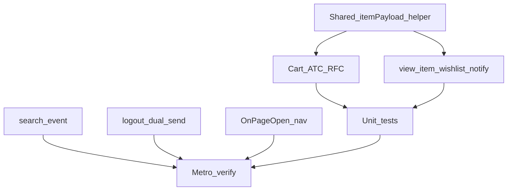

# PushApp Event App Fixes (No TestFlight)

**Goal:** Fix all **in-app Mehery/PushApp event issues** from the observation/Excel sheet (payloads, dual-send, lifecycle wiring). Verify with unit tests + Metro/simulator logs.

**Hard constraint:** Do **not** archive, export, upload, or otherwise push anything to TestFlight / App Store Connect. Leave iOS build number alone for this workstream.

**Scope (locked):** APP Brew host [`src/mehery/`](src/mehery/) + vendored SDK under [`vendor/react-native-mehery-event-sender/`](vendor/react-native-mehery-event-sender/) only if an event bug is in the SDK. Do not edit `Desktop/msdk/**`.

## In scope — event app issues

| Issue | Fix |
|-------|-----|
| Missing `items.url` / `item_brand` / `item_category` / weak `img_url` on cart (and wishlist/notify if dual-sent) | Enrich builders in [`cartPressEvents.tsx`](src/mehery/cartPressEvents.tsx); mirror for wishlist/notify if needed |
| `search` captured only as `screen_view` (“Search suggestions”) | Emit `search` + `search_term` on submit/results; keep `screen_view` for the screen |
| `logout` / OnUserLogOut not visible as Excel `logout` | Dual-send `logout` on `SIGNOUT_SUCCESS` in [`identityListeners.ts`](src/mehery/identityListeners.ts) |
| `OnPageOpen` / page open not working | Wire [`meheryOnPageOpen`](src/mehery/navigation.ts) / `meheryOnPageClose` to root nav focus |
| `app_install` missing `version` / `sizeWidth` / `sizeHeight` | Confirm SDK [`LifecycleEvents.ts`](vendor/react-native-mehery-event-sender/src/events/default/LifecycleEvents.ts) + host enrichment in [`sendCustomEvent.ts`](src/mehery/sendCustomEvent.ts); fix if host strips fields |
| `add_to_cart` / cart events missing item props; “not in events analytics” | Fix payload first; confirm `/v1/event` POST with `event_name: add_to_cart` (LOG type is intentional) |
| `view_item` / `view_item_list` / wishlist / notify missing `url` (and brand/category where applicable) | Same item-shape helper used everywhere Mehery builds `items[]` |
| `login` appearing as App open | Document: SDK `OnAppOpen` after link is by design; ensure Gauntlet `login` still dual-sends via `MeheryTracker.sendEvent` when fired — fix host if `login` never reaches tracker |

## Explicitly out of scope (this pass)

- **Any TestFlight / ASC upload / archive**
- Device statistics blank (legacy), Device column click (dashboard)
- Journey Test23 bulk push (dashboard/FCM)
- Daily auto-logout (host session — separate track)
- Cross-email same profile (backend identity)
- Roadblock with no campaign (already done)
- iOS profile linking / Device 3→1 / profile PUT shape (already fixed; not event analytics)
- Mounting Inline/Tooltip placeholders without real `placeholder_id`s
- Claiming `updateUserProfile` must appear in Event Analytics (it is a profile PUT, not a custom event)

---

## Implementation

### 1. Shared item payload helper

Create a small helper (e.g. [`src/mehery/itemPayload.ts`](src/mehery/itemPayload.ts)) that maps product/line-item sources → Excel item keys:

- `item_id`, `handle`, `item_name`, `item_variant`, `price`, `original_price`, `discount`, `sku`, `quantity`
- `url` (shop product URL from handle)
- `item_brand`, `item_category`
- `img_url`

Use it from cart ATC/RFC builders and any wishlist/notify/view_item dual-send paths.

### 2. Cart dual-send ([`cartPressEvents.tsx`](src/mehery/cartPressEvents.tsx))

Replace inline item objects with the helper. Keep `sendMeheryCustomEvent(..., 'LOG')`.

### 3. Search

Find search submit / query application in the app (Gauntlet search screen or store). On committed search term, call:

`sendMeheryCustomEvent('search', { search_term: term }, 'LOG')`

Do not treat suggestion-screen focus alone as `search`.

### 4. Logout

In [`identityListeners.ts`](src/mehery/identityListeners.ts) on `SIGNOUT_SUCCESS`: fire `logout` custom event, then existing `setUserDetails(undefined)` / delink path.

### 5. Page open

Wire `meheryOnPageOpen(screenName)` on primary navigation focus and `meheryOnPageClose` on blur (same place App Brew tracks screens if one exists; otherwise navigation container state listener).

### 6. `app_install` / `login` audit

- Trace cold start: ensure `app_install` POST includes `version`, `sizeWidth`, `sizeHeight`.
- Trace login: ensure `login` with `method` hits `/v1/event` when analytics fires; do not remove SDK `OnAppOpen`.

### 7. Tests (required per event fix)

| Test | Asserts |
|------|---------|
| `itemPayload` unit tests | url/brand/category/img_url present when inputs exist; omit empties |
| Cart builder tests | `add_to_cart` / `remove_from_cart` payloads include Excel item keys |
| Search emit test (unit or thin integration) | `search_term` forwarded |
| Logout listener test | `logout` sent on SIGNOUT (mock `sendMeheryCustomEvent`) |
| Page open wiring smoke | focus calls `OnPageOpen` (mock SDK) |

Manual Metro checks (simulator OK; **no TF**): ATC, search submit, logout, navigate tabs → confirm `/v1/event` names + properties.

---

## Deliverable

Events Pass/Fail matrix: [`2026-09-15-pushapp-qa-matrix.md`](2026-09-15-pushapp-qa-matrix.md) (filled after implementation; no TF).

### Implementation status (2026-09-15)

- [x] Shared `itemPayload` + cart ATC/RFC enrichment + unit tests  
- [x] Wishlist / analytics item enrich (`url`, brand, category, `img_url`)  
- [x] Search dual-send (`search_term`, LOG)  
- [x] Logout dual-send on `SIGNOUT_SUCCESS`  
- [x] OnPageOpen/Close via `MeheryTracker.sendScreenView`  
- [x] `app_install` / `login` code-path audit (unit + tracker LOG)  
- [x] Events matrix Pass/Fail  
- [x] **No TestFlight**

## Execution order

1. Item helper + cart enrichment + unit tests  
2. Wishlist/notify/view_item if gaps remain  
3. Search dual-send  
4. Logout dual-send  
5. OnPageOpen wiring  
6. app_install / login Metro audit  
7. Fill events matrix Pass/Fail  

## Out of scope reminder

- **No TestFlight**  
- No dashboard/backend patches  
- No profile-link rework in this pass
