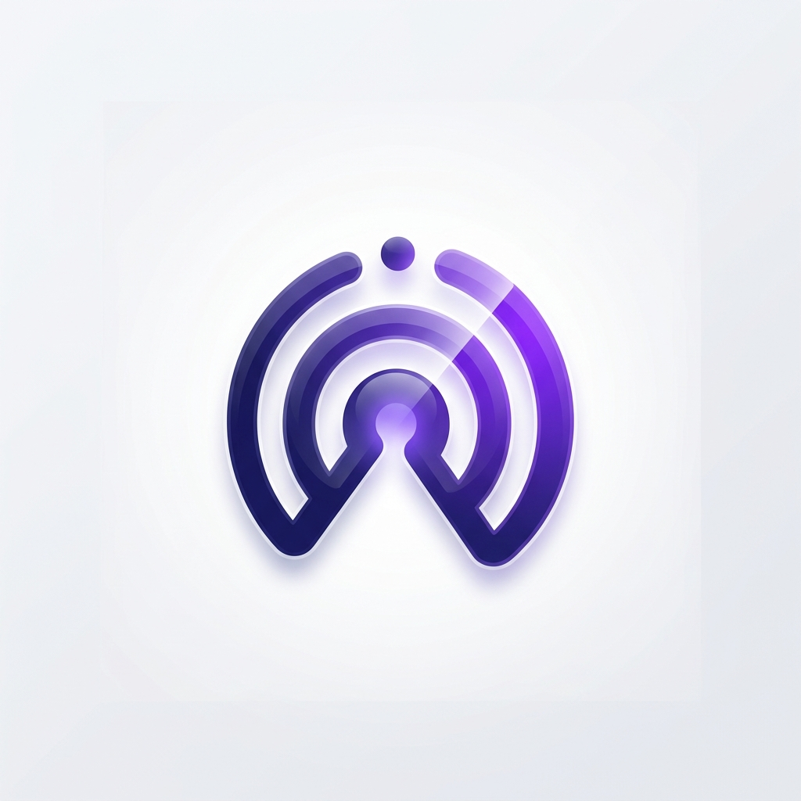

# react-native-pushapp-appbrew

[](https://github.com/mehery-soccom/PushApp-React-Native/blob/main/LICENSE)

PushApp (Mehery) SDK for **App Brew** apps (`@gauntlet/*` · React Native 0.81 · Re.Pack/rspack · pnpm): push notifications, in-app polls and event tracking.



## Overview

This package is the App Brew build of [`react-native-mehery-event-sender`](https://github.com/mehery-soccom/PushApp-React-Native). It has the same JS API, plus one extra entry point for App Brew apps:

```ts
import { setupPushApp, PushAppRoot } from 'react-native-pushapp-appbrew/appbrew'
```

`setupPushApp({...})` connects PushApp to the App Brew internals (analytics, login, cart, wishlist, search, the block registry). `<PushAppRoot />` starts the SDK and mounts the poll overlay. You don't copy any glue code into your app.

> **PushApp and Mehery are the same product.** The platform is called PushApp, and its company is Mehery. Some SDK names still say "Mehery" (`loadMeherySdk`, `sendMeheryCustomEvent`, `MeheryProfileUserGreeting`, `[Mehery]` log lines, `Mehery*` keys in `Info.plist`). Search for either name when debugging.

### Key features

- Rich push notifications with images, carousels, action buttons and Live Activities
- Interactive polls in overlay, inline and tooltip containers
- Automatic event tracking for login, page open, app lifecycle and commerce events
- User lifecycle management: link and unlink devices, and sync profiles
- Background notification handling on Android and iOS

## Getting started

Roughly in this order. Android and the JavaScript side are quick. iOS takes longest because of the Xcode extension targets, and you only need those for rich push.

1. **Get your PushApp details** (from the PushApp dashboard; ask your PushApp contact if you don't have a tenant yet):
   - the **channel id**, in the form `<tenant>_<number>`
   - an **app id / app key** pair (`pa_…` / `pas_…`) for each environment you'll use
2. **Get your Firebase files** for your bundle id / package name: `google-services.json` and `GoogleService-Info.plist`. Upload an **APNs auth key** to the Firebase project.
3. **Install** the package and apply the [pnpm and rspack changes](#installation).
4. **Android:** [a handful of edits](#android), mostly copy-paste.
5. **iOS:** [capabilities, `Info.plist`, the native files, `AppDelegate`](#ios), then the [extensions](#ios-notification-extensions) you need.
6. **JavaScript:** [`index.js`, `App.tsx`, one block override](#set-up-in-code).
7. **Check it works** with the [test pushes](#verify-it-works).

## Prerequisites checklist

> **Important:** Your app will not receive notifications correctly if any of these steps are skipped.

**Accounts and files**

- [ ] PushApp channel id and app id/key pairs
- [ ] Firebase project for your bundle id / package name, with an APNs auth key uploaded
  - Android: `android/app/google-services.json`
  - iOS: `ios/GoogleService-Info.plist`
- [ ] Apple Developer portal access (App IDs, App Group, provisioning profiles) if you use iOS extensions

**Code**

- [ ] [Install](#installation) the package and its peers, and add the **pnpm overrides**
- [ ] Apply the [rspack changes](#rspack-config-required)
- [ ] [Android](#android): remove the RNFB messaging service, add the push-notification meta-data, Gradle settings and credentials
- [ ] [iOS](#ios): capabilities, `Info.plist` keys, `PushTokenManager`, bridging header, `AppDelegate` blocks
- [ ] [iOS extensions](#ios-notification-extensions): only for rich images, carousels or Live Activities
- [ ] [`index.js`](#background-handler-indexjs): background FCM handler before `AppRegistry`
- [ ] [`App.tsx`](#wire-apptsx): `setupPushApp(...)` and `<PushAppRoot />`
- [ ] [`register-blocks.ts`](#mount-polls): the account block, if you want inline or tooltip polls

## Installation

```bash
pnpm add react-native-pushapp-appbrew@^1.0.1 \
  @react-native-async-storage/async-storage@^3.1.1 \
  @react-native-community/push-notification-ios@^1.12.0 \
  react-native-push-notification@^8.1.1
```

The `react-native-pushapp-appbrew/appbrew` entry point is available from version `1.0.1`. If you install from a local folder instead, point `package.json` at it (`"react-native-pushapp-appbrew": "file:./vendor/react-native-pushapp-appbrew"`) and **run `pnpm install` again after every change to that folder**, because pnpm copies it into `node_modules`.

The App Brew template already ships `@react-native-firebase/app`, `@react-native-firebase/messaging`, `@notifee/react-native`, `react-native-webview`, `react-native-video`, `react-native-device-info`, `react-native-localize` and `@react-native-community/netinfo`.

**`pnpm-workspace.yaml` (required).** The SDK declares different versions than the ones your app links natively. Force a single copy of each:

```yaml
overrides:
  # SDK wants ^2.2.0; the app binary links 3.x. JS must match the native module.
  '@react-native-async-storage/async-storage': 3.1.1
  # Two copies both call requireNativeComponent('RCTVideo') and crash.
  react-native-video: 6.16.1
```

> **Recommended:** also pin `@react-native-firebase/app`, `@react-native-firebase/messaging`, `react-native-device-info` and `react-native-localize` to your app's versions. The SDK declares RNFB `^22.4`, device-info `^15` and localize `^3.6`, so it can bundle JS that doesn't match your native code. See [Known issues](#known-issues).

```bash
pnpm install
pnpm pod-install
```

### rspack config (required)

Make four changes to `rspack.config.mjs`:

```js
import path from 'node:path'
import { createRequire } from 'node:module'
import { createAppConfig } from '@app-brew/build-tools/rspack-config.mjs'
import rspack from '@rspack/core'

const require = createRequire(import.meta.url)
const pushappPkgJson = require.resolve('react-native-pushapp-appbrew/package.json')
const asyncStorageReal = require.resolve('@react-native-async-storage/async-storage')
const asyncStorageCompat = path.resolve(
  path.dirname(pushappPkgJson),
  'src/appbrew/asyncStorageCompat.ts'
)

const baseConfigFactory = createAppConfig({
  name: '<your-app-name>',              // must equal app.json "name"
  appDir: import.meta.dirname,
  monorepoRoot: import.meta.dirname,
  extraPlugins: [
    // 1. SDK helpers import ../../package.json; point them at the real file.
    new rspack.NormalModuleReplacementPlugin(/package\.json$/, (resource) => {
      if (
        resource.context.includes(
          `${path.sep}react-native-pushapp-appbrew${path.sep}lib${path.sep}module${path.sep}helpers`
        ) &&
        (resource.request === '../../package.json' ||
          resource.request.endsWith(`${path.sep}lib${path.sep}package.json`))
      ) {
        resource.request = pushappPkgJson
      }
    }),
    // 2. Keep dynamic import() in the main bundle (RN can't execute split chunks here).
    new rspack.optimize.LimitChunkCountPlugin({ maxChunks: 1 }),
  ],
})

export default (env) => {
  const config = baseConfigFactory(env)
  // 3.
  config.output = { ...config.output, globalObject: 'globalThis' }
  // 4. AsyncStorage 3.x dropped multiGet/multiSet/multiRemove, which the SDK still calls.
  config.resolve = {
    ...config.resolve,
    alias: {
      ...config.resolve?.alias,
      'async-storage-real$': asyncStorageReal,
      '@react-native-async-storage/async-storage$': asyncStorageCompat,
    },
  }
  return config
}
```

### Rule: never import the SDK statically

The SDK can stall on a circular import under Re.Pack if it's evaluated at startup. `PushAppRoot` and `setupPushApp` load it lazily for you. In your own code, use the loader:

```ts
// ❌ Can stall at startup
import { initSdk } from 'react-native-pushapp-appbrew'

// ✅ Lazy loader
import { loadMeherySdk, ensureSdkReady } from 'react-native-pushapp-appbrew/appbrew'
const sdk = await loadMeherySdk()    // module only
const ready = await ensureSdkReady() // module + init finished
```

## Platform configuration

### Android

#### What the SDK adds for you

The SDK manifest is merged into your app and the package is autolinked, so you **do not** add any of these:

- `MyFirebaseMessagingService`
- `CarouselReceiver`
- `NotificationActionReceiver`
- `NotificationCtaUrlActivity`
- the `RNPushNotificationActions` receiver
- the permissions `INTERNET`, `WAKE_LOCK` and `POST_NOTIFICATIONS`
- the native modules `MeheryAppConfig`, `MeheryPushTrack` and `LiveActivityModule`

You also do not edit `MainApplication.kt`.

#### Gradle

`android/build.gradle`: the template already has the classpath. Add `supportLibVersion`:

```gradle
buildscript {
  ext {
    // react-native-push-notification uses AndroidX only when this major is < 20;
    // otherwise it pulls com.android.support:appcompat-v7 and clashes.
    supportLibVersion = "1.6.1"
  }
  dependencies {
    classpath("com.google.gms:google-services:4.4.3")
  }
}
```

`android/app/build.gradle` (the template already has this):

```gradle
apply plugin: "com.google.gms.google-services"
```

`android/gradle.properties`:

```properties
org.gradle.jvmargs=-Xmx4096m -XX:MaxMetaspaceSize=1024m -XX:+HeapDumpOnOutOfMemoryError -Dfile.encoding=UTF-8
kotlin.daemon.jvmargs=-Xmx2048m
android.useAndroidX=true
# Convert react-native-push-notification's leftover support-lib artifacts
android.enableJetifier=true
# Jetifying these AARs runs out of memory on RN 0.81, and they are already AndroidX
android.jetifier.ignorelist=react-android,hermes-android
```

#### One Firebase messaging service (required for background rich push)

React Native Firebase registers `io.invertase.firebase.messaging.ReactNativeFirebaseMessagingService`, whose `onMessageReceived` does nothing. The SDK registers its own `com.meheryeventsender.MyFirebaseMessagingService`, which extends `FirebaseMessagingService` and builds the BigPicture, carousel, custom-layout and CTA notifications.

If **both** services end up in the merged manifest, background pushes can reach the wrong one, and **images and action buttons won't show**. The SDK does **not** remove the RNFB service for you.

In `android/app/src/main/AndroidManifest.xml`, declare `xmlns:tools` on `<manifest>`. Then, inside `<application>`:

```xml
<!-- PushApp owns background rich FCM. Remove RNFB's no-op messaging service. -->
<service
  android:name="io.invertase.firebase.messaging.ReactNativeFirebaseMessagingService"
  android:exported="false"
  tools:node="remove" />

<!-- Stop react-native-push-notification from drawing a second copy in the foreground -->
<meta-data
  android:name="com.dieam.reactnativepushnotification.notification_foreground"
  android:value="false" />
<meta-data
  android:name="com.dieam.reactnativepushnotification.notification_color"
  android:resource="@android:color/white" />
```

**Recommended:** add this so external `https` CTA URLs open in the browser on Android 11+. Without it, the SDK falls back to opening the app.

```xml
<queries>
  <intent>
    <action android:name="android.intent.action.VIEW" />
    <category android:name="android.intent.category.BROWSABLE" />
    <data android:scheme="https" />
  </intent>
</queries>
```

**Deep links.** Keep your store App Link filters and custom-scheme intent filter on `MainActivity`. They must use the same scheme and hosts you pass to `setupPushApp` as `appScheme` and `httpsHosts`.

**Notification icon.** The SDK uses `mipmap/ic_launcher` as the small icon. A full-colour adaptive launcher icon shows up as a white blob, so ship a monochrome `ic_launcher` if you can. See [Known issues](#known-issues).

#### Native FCM logs (logcat)

```text
adb logcat -s MyFirebaseMessagingService:I
```

If no `MyFirebaseMessagingService` lines appear when a push arrives in the background, `onMessageReceived` did not run. Check two things:

- `tools:node="remove"` is in place.
- The push is **data-only** and high priority. A top-level FCM `notification` block skips the service while the app is in the background.

After install or a token refresh, `Mehery FCM: onNewToken` confirms the service is active.


### iOS

The SDK pod (`MeheryEventSender`, autolinked) contains only `MeheryAppConfig`, which reads credentials from `Info.plist`, plus a view manager. Everything else on iOS is code in **your** app. Ready-made copies of all of it ship in this package under `templates/ios/` (see [Where the template files are](#where-the-template-files-are)), and the two extensions you need most are shown in full below.

#### Where the template files are

They are inside the installed package, not in a repository you need access to:

```
node_modules/react-native-pushapp-appbrew/templates/ios/
├── App/                    PushTokenManager, MeheryPushHelpers, Live Activity (real + stub), AppDelegate/SceneDelegate references
├── minimal/                short service and content extensions (the code shown below)
├── ImageNotification/      full service extension
├── ImagePreviewExtension/  full content extension
└── DeliveryActivity/       Live Activity widget extension
```

Copy files from there into your Xcode project. Your package manager may place `node_modules` elsewhere (for example `node_modules/.pnpm/...`); `pnpm list react-native-pushapp-appbrew` or `node -p "require.resolve('react-native-pushapp-appbrew/package.json')"` shows the real folder.

#### 1. Capabilities (main app target)

- **Push Notifications**
- **Background Modes** → Remote notifications (and Background fetch)
- **App Groups**: only for Live Activity
- **Associated Domains**: only for universal links

#### 2. `Info.plist` (main app)

```xml
<key>UIBackgroundModes</key>
<array>
  <string>remote-notification</string>
  <string>fetch</string>
</array>
<!-- Live Activity only -->
<key>NSSupportsLiveActivities</key>
<true/>
<key>NSSupportsLiveActivitiesFrequentUpdates</key>
<true/>
```

Also add your URL scheme under `CFBundleURLTypes` (the same one you pass as `appScheme`), and the [credentials](#app-credentials).

#### 3. Entitlements (main app)

| Key | Value | Needed for |
|---|---|---|
| `aps-environment` | `production` (or `development` for debug builds) | Push |
| `com.apple.security.application-groups` | `group.<bundle-id>.NotificationLiveActivity` | Live Activity |
| `com.apple.developer.associated-domains` | `applinks:<your-store-host>` | Universal links |

#### 4. Native files to copy (required)

Copy these from `templates/ios/App/` (see [Where the template files are](#where-the-template-files-are)) into the main app target:

| File | Why |
|---|---|
| `PushTokenManager.swift` + `PushTokenManager.m` | The React Native event emitter the SDK uses (`NativeModules.PushTokenManager`). Emits `PushTokenEvent` and `PushNotificationEvent`, queues taps that arrive before JS is ready, and draws local notifications for data-only pushes. Copy as-is. |
| `MeheryPushHelpers.swift` | Payload helpers `AppDelegate` calls (`mergedNotificationFields`, `isSilentNoUiPush`, `apnsPayloadIncludesVisibleAlert`, …). **Always required.** |
| **One of:** `MeheryLiveActivityStub.swift` **or** `MeheryLiveActivity.swift` | `AppDelegate` calls `shouldStartLiveActivity` and `startLiveActivity`. Use the **stub** (a no-op) if you're not adding Live Activity. Use the **real file** only if you do [section C](#c-live-activity-widget-extension): it also needs `DeliveryActivityLiveActivity.swift` and `MeheryAppGroup.swift` in the app target, or the build fails with "cannot find type `DeliveryActivityAttributes`". |
| Bridging header | Add the import below. |

```objc
#if __has_include(<RNCPushNotificationIOS/RNCPushNotificationIOS.h>)
#import <RNCPushNotificationIOS/RNCPushNotificationIOS.h>
#elif __has_include(<RNCPushNotificationIOS.h>)
#import <RNCPushNotificationIOS.h>
#endif
```

#### 5. `AppDelegate.swift`

Merge these blocks into yours (the full file is `templates/ios/App/AppDelegate.swift`):

1. **Class declaration:** `class AppDelegate: UIResponder, UIApplicationDelegate, UNUserNotificationCenterDelegate, MessagingDelegate`, plus `import Firebase` and `import UserNotifications`.
2. **`didFinishLaunching`, before the React Native factory:**
   ```swift
   if FirebaseApp.app() == nil { FirebaseApp.configure() }
   Messaging.messaging().delegate = self
   UNUserNotificationCenter.current().delegate = self
   registerNotificationCategories()
   ```
3. **Register for remote notifications _unconditionally_, then ask for permission.** Registering only when `granted` skips registration on TestFlight.
   ```swift
   application.registerForRemoteNotifications()
   UNUserNotificationCenter.current().requestAuthorization(options: [.alert, .sound, .badge]) { _, _ in
     DispatchQueue.main.async { application.registerForRemoteNotifications() }
   }
   ```
4. **APNs token → SDK:**
   ```swift
   func application(_ application: UIApplication,
                    didRegisterForRemoteNotificationsWithDeviceToken deviceToken: Data) {
     let apnsToken = deviceToken.map { String(format: "%02.2hhx", $0) }.joined()
     Messaging.messaging().apnsToken = deviceToken
     PushTokenManager.sendTokenEvent("apns", token: apnsToken)
     RNCPushNotificationIOS.didRegisterForRemoteNotifications(withDeviceToken: deviceToken)
   }
   ```
   Also forward `didFailToRegisterForRemoteNotificationsWithError` to `RNCPushNotificationIOS`.
5. **Do _not_ forward the FCM token** through `PushTokenManager`. The listener treats every token as the APNs token. If you send FCM first and then APNs, PushApp replaces the session id and `/device/link` fails. JS already reads the FCM token separately.
6. **Background and data-only pushes** (`didReceiveRemoteNotification`). Forwards the push to JS, handles silent pings, draws data-only pushes while the app isn't active, and starts a Live Activity if the payload asks for one. Replace your existing method with:
   ```swift
     func application(
       _ application: UIApplication,
       didReceiveRemoteNotification userInfo: [AnyHashable: Any],
       fetchCompletionHandler completionHandler: @escaping (UIBackgroundFetchResult) -> Void
     ) {
       print("📦 Background push received: \(userInfo)")

       let merged = mergedNotificationFields(userInfo)

       if isSilentNoUiPush(merged: merged, userInfo: userInfo) {
         PushTokenManager.sendNotificationEventOrQueue(dictToAnyHashable(merged))
         RNCPushNotificationIOS.didReceiveRemoteNotification(userInfo)
         completionHandler(.newData)
         return
       }

       PushTokenManager.sendNotificationEventOrQueue(dictToAnyHashable(merged))

       // Data-only FCM (no `aps.alert`) reaches the app but iOS never draws a banner.
       if UIApplication.shared.applicationState != .active,
          !apnsPayloadIncludesVisibleAlert(userInfo) {
         let title = stringFromAny(merged["title"])?.trimmingCharacters(in: .whitespacesAndNewlines) ?? ""
         let body = stringFromAny(merged["body"])?.trimmingCharacters(in: .whitespacesAndNewlines) ?? ""
         let category = stringFromAny(merged["category"])?.trimmingCharacters(in: .whitespacesAndNewlines)
           ?? "CAROUSEL_CATEGORY"
         PushTokenManager.scheduleDisplayNotification(
           title: title,
           body: body,
           category: category,
           data: merged,
           identifierPrefix: "mehery-bg",
           deliverToJs: false
         )
       }

       if #available(iOS 16.1, *) {
         if shouldStartLiveActivity(merged: merged) {
           RNCPushNotificationIOS.didReceiveRemoteNotification(userInfo)
           startLiveActivity(userInfo: userInfo) {
             completionHandler(.newData)
           }
           return
         }
       }

       RNCPushNotificationIOS.didReceiveRemoteNotification(
         userInfo,
         fetchCompletionHandler: completionHandler
       )
     }
   ```
   `startLiveActivity` and `shouldStartLiveActivity` come from `MeheryLiveActivity.swift`, or from `MeheryLiveActivityStub.swift` if you skip Live Activity (see step 4).
7. **Foreground pushes** (`willPresent`). Forwards to JS and shows a banner, except for silent pushes:
   ```swift
     func userNotificationCenter(
       _ center: UNUserNotificationCenter,
       willPresent notification: UNNotification,
       withCompletionHandler completionHandler: @escaping (UNNotificationPresentationOptions) -> Void
     ) {
       let userInfo = notification.request.content.userInfo
       let merged = mergedNotificationFields(userInfo)
       PushTokenManager.sendNotificationEventOrQueue(dictToAnyHashable(merged))
       if isSilentNoUiPush(merged: merged, userInfo: userInfo) {
         completionHandler([])
         return
       }
       if #available(iOS 14.0, *) {
         completionHandler([.banner, .list, .sound, .badge])
       } else {
         completionHandler([.alert, .sound, .badge])
       }
     }
   ```
8. **Taps** (`didReceive`). Forwards the tap (with the action id) to JS and opens the notification's link. **Set `allowedUrlSchemes` to your own URL scheme** or taps on your app's links will be ignored:
   ```swift
     func userNotificationCenter(
       _ center: UNUserNotificationCenter,
       didReceive response: UNNotificationResponse,
       withCompletionHandler completionHandler: @escaping () -> Void
     ) {
       RNCPushNotificationIOS.didReceive(response)
       let userInfo = response.notification.request.content.userInfo
       var merged = mergedNotificationFields(userInfo)
       merged["actionIdentifier"] = response.actionIdentifier
       merged["categoryIdentifier"] = response.notification.request.content.categoryIdentifier
       PushTokenManager.sendNotificationEventOrQueue(dictToAnyHashable(merged))
       if let url = urlForNotificationBody(userInfo: userInfo) {
         DispatchQueue.main.async {
           UIApplication.shared.open(url, options: [:], completionHandler: nil)
         }
       }
       completionHandler()
     }

     /// CHANGE THIS: your app's URL scheme(s). http(s) links are always allowed.
     private static let allowedUrlSchemes: [String] = ["your-app-scheme"]

     /// Prefer `notification_url` / `notificationUrl` from PushApp payloads (also nested under `data`).
     private func urlForNotificationBody(userInfo: [AnyHashable: Any]) -> URL? {
       var merged: [AnyHashable: Any] = userInfo
       if let dataDict = userInfo["data"] as? [AnyHashable: Any] {
         for (k, v) in dataDict { merged[k] = v }
       } else if let dataStr = userInfo["data"] as? String,
                 let data = dataStr.data(using: .utf8),
                 let obj = try? JSONSerialization.jsonObject(with: data) as? [AnyHashable: Any] {
         for (k, v) in obj { merged[k] = v }
       }
       let keys = ["notification_url", "notificationUrl", "url", "deeplink", "deep_link"]
       for key in keys {
         if let raw = merged[key] as? String,
            let url = URL(string: raw),
            let scheme = url.scheme?.lowercased(),
            scheme == "http" || scheme == "https" || Self.allowedUrlSchemes.contains(scheme) {
           return url
         }
       }
       return nil
     }
   ```
9. **`registerNotificationCategories()`:** registers the `PUSHAPP_*` action sets. The category ids **must match** the content extension's `Info.plist` (see [below](#b-carousel-and-action-buttons-content-extension)). The template registers all 21; the smallest working set is:
   ```swift
   func registerNotificationCategories() {
     func category(_ id: String, _ actions: [(String, String)]) -> UNNotificationCategory {
       UNNotificationCategory(
         identifier: id,
         actions: actions.map { UNNotificationAction(identifier: $0.0, title: $0.1, options: [.foreground]) },
         intentIdentifiers: [], options: [])
     }
     UNUserNotificationCenter.current().setNotificationCategories([
       category("CAROUSEL_CATEGORY", [("PUSHAPP_OPT_IN", "Opt In"), ("PUSHAPP_NOT_INTERESTED", "Not Interested")]),
       category("THREE_BUTTON_CATEGORY", [("PUSHAPP_ACTION_1", "Action 1"), ("PUSHAPP_ACTION_2", "Action 2"), ("PUSHAPP_ACTION_3", "Action 3")]),
     ])
   }
   ```

**Xcode 27 / iOS 27 only (build fix, not part of the SDK):** also copy `SceneDelegate.swift`, the `UIApplicationSceneManifest` Info.plist entry and the `configurationForConnecting` hook from the template. Change `withModuleName: "natori"` to your `app.json` name.

#### 6. Podfile

Add an empty target for each notification extension you create:

```ruby
target 'ImageNotification' do         # service extension
end
target 'ImagePreviewExtension' do     # content extension
end
target 'DeliveryActivityExtension' do # Live Activity widget
end
```

Optional build fixes in `post_install`: quote `$WITH_ENVIRONMENT` when the repo path contains spaces, and set a minimum deployment target of 15.0 for Xcode 27. After `pod install`, `Podfile.lock` should list `MeheryEventSender`, `RNCPushNotificationIOS` and `AsyncStorage`.

### iOS notification extensions

You only need these for rich push. Plain text pushes, token registration, silent pings and polls work without any of them.

| You want | Targets you need |
|---|---|
| Image in the notification | A: service extension |
| Carousel, action buttons | A + B: service extension and content extension |
| Live Activity | C: widget extension (and the App Group) |

**For each new target in Xcode:**
1. File → New → Target, then replace the generated files with the ones below.
2. Bundle id `<app-bundle-id>.<Suffix>` (`.ImageNotification`, `.ImagePreviewExtension`, `.DeliveryActivity`).
3. Same team, `MARKETING_VERSION` and `CURRENT_PROJECT_VERSION` as the app.
4. Check it is under the app's **Embed Foundation Extensions** build phase, and in its target dependencies.
5. Add the empty Podfile `target` and run `pod install` again.

**Apple Developer portal:** App IDs for the app (Push Notifications, App Groups, Associated Domains) and for each extension; the App Group `group.<bundle-id>.NotificationLiveActivity`; provisioning profiles that cover all of them; the APNs auth key uploaded to Firebase.

#### A. Rich images (service extension)

The App Brew template already has an `ImageNotification` target. Replace its `NotificationService.swift` with the code below. It reads the image URL(s) from the payload, downloads and attaches them, and stores the full list for the carousel. A fuller version (with extra logging) is `templates/ios/ImageNotification/`.

In this target's `Info.plist`, `NSExtensionPrincipalClass` must be `$(PRODUCT_MODULE_NAME).NotificationService`. No entitlements or Firebase pods are needed.

```swift
import UserNotifications
import UIKit

/// PushApp service extension: downloads the image(s) in the payload and attaches them.
/// Also writes the full list to userInfo["images"] so the content extension can build a carousel.
class NotificationService: UNNotificationServiceExtension {
    private var contentHandler: ((UNNotificationContent) -> Void)?
    private var bestAttempt: UNMutableNotificationContent?

    override func didReceive(_ request: UNNotificationRequest,
                             withContentHandler contentHandler: @escaping (UNNotificationContent) -> Void) {
        self.contentHandler = contentHandler
        guard let content = request.content.mutableCopy() as? UNMutableNotificationContent else {
            contentHandler(request.content); return
        }
        bestAttempt = content

        let info = Self.flatten(request.content.userInfo)
        let urls = Self.imageUrls(from: info)
        guard !urls.isEmpty else { contentHandler(content); return }

        // Hand the whole list to the content extension (carousel).
        var updated = info
        updated["images"] = urls
        updated["media-url"] = urls
        content.userInfo = updated

        let group = DispatchGroup()
        var attachments = [UNNotificationAttachment?](repeating: nil, count: urls.count)
        for (i, s) in urls.enumerated() {
            guard let url = URL(string: s) else { continue }
            group.enter()
            Self.download(url) { file in
                if let file = file {
                    attachments[i] = try? UNNotificationAttachment(identifier: "image_\(i)", url: file)
                }
                group.leave()
            }
        }
        group.notify(queue: .main) {
            content.attachments = attachments.compactMap { $0 }
            contentHandler(content)
        }
    }

    override func serviceExtensionTimeWillExpire() {
        if let handler = contentHandler, let content = bestAttempt { handler(content) }
    }

    // MARK: - Payload

    /// FCM often nests custom keys under `data` (dictionary or JSON string).
    private static func flatten(_ userInfo: [AnyHashable: Any]) -> [AnyHashable: Any] {
        var merged = userInfo
        if let d = userInfo["data"] as? [AnyHashable: Any] {
            d.forEach { merged[$0.key] = $0.value }
        } else if let s = userInfo["data"] as? String,
                  let data = s.data(using: .utf8),
                  let obj = try? JSONSerialization.jsonObject(with: data) as? [String: Any] {
            obj.forEach { merged[$0.key] = $0.value }
        }
        return merged
    }

    private static func imageUrls(from info: [AnyHashable: Any]) -> [String] {
        func str(_ v: Any?) -> String? {
            let s = (v as? String)?.trimmingCharacters(in: .whitespacesAndNewlines)
            return (s?.isEmpty == false) ? s : nil
        }
        func list(_ v: Any?) -> [String] {
            if let a = v as? [Any] { return a.compactMap { str($0) } }
            if let s = str(v) {
                if let d = s.data(using: .utf8), let a = try? JSONSerialization.jsonObject(with: d) as? [Any] {
                    return a.compactMap { str($0) }
                }
                return s.split(separator: ",").map { String($0).trimmingCharacters(in: .whitespaces) }
                    .filter { !$0.isEmpty }
            }
            return []
        }
        if let fcm = info["fcm_options"] as? [AnyHashable: Any], let s = str(fcm["image"]) { return [s] }
        for key in ["image_urls", "imageUrls", "carousel_images", "images", "media-url"] {
            let l = list(info[key]); if !l.isEmpty { return l }
        }
        for key in ["image_url", "imageUrl", "image"] {
            if let s = str(info[key]) { return [s] }
        }
        var out: [String] = []   // image1, image2, ...
        var i = 1
        while let s = str(info["image\(i)"]) { out.append(s); i += 1 }
        return out
    }

    // MARK: - Download

    private static func download(_ url: URL, completion: @escaping (URL?) -> Void) {
        let cfg = URLSessionConfiguration.ephemeral
        cfg.timeoutIntervalForRequest = 12
        cfg.timeoutIntervalForResource = 12
        URLSession(configuration: cfg).downloadTask(with: url) { tmp, _, error in
            guard error == nil, let tmp = tmp, let data = try? Data(contentsOf: tmp),
                  // Re-encode as baseline JPEG: iOS shows progressive JPEGs as a white card when expanded.
                  let jpeg = UIImage(data: data)?.jpegData(compressionQuality: 0.9) else {
                completion(nil); return
            }
            let out = URL(fileURLWithPath: NSTemporaryDirectory()).appendingPathComponent("img_\(UUID().uuidString).jpg")
            completion((try? jpeg.write(to: out, options: .atomic)) != nil ? out : nil)
        }.resume()
    }
}
```

The push needs `mutable-content: 1` in `aps`, or iOS never starts this extension. See [test pushes](#verify-it-works).

#### B. Carousel and action buttons (content extension)

Create a **Notification Content Extension** target named `ImagePreviewExtension`. Delete the storyboard Xcode generates (this version builds its UI in code) and replace `NotificationViewController.swift` with the code below. A fuller version (branded header, logo, auto-scroll resume, page scrim) is `templates/ios/ImagePreviewExtension/`.

Its `Info.plist` `NSExtension` block:

```xml
<key>NSExtension</key>
<dict>
  <key>NSExtensionAttributes</key>
  <dict>
    <key>UNNotificationExtensionCategory</key>
    <array>
      <!-- Every category id you send. Must match registerNotificationCategories(). -->
      <string>CAROUSEL_CATEGORY</string>
      <string>THREE_BUTTON_CATEGORY</string>
    </array>
    <key>UNNotificationExtensionDefaultContentHidden</key>
    <true/>
    <key>UNNotificationExtensionInitialContentSizeRatio</key>
    <real>0.5</real>
    <key>UNNotificationExtensionUserInteractionEnabled</key>
    <true/>
  </dict>
  <key>NSExtensionPointIdentifier</key>
  <string>com.apple.usernotifications.content-extension</string>
  <key>NSExtensionPrincipalClass</key>
  <string>$(PRODUCT_MODULE_NAME).NotificationViewController</string>
</dict>
```

(Remove any `NSExtensionMainStoryboard` key.) Link `UserNotifications` and `UserNotificationsUI`.

```swift
import UIKit
import UserNotifications
import UserNotificationsUI

/// PushApp content extension: title, body and a swipeable image carousel.
/// Programmatic: no storyboard. Set NSExtensionPrincipalClass to
/// $(PRODUCT_MODULE_NAME).NotificationViewController in this target's Info.plist.
class NotificationViewController: UIViewController, UNNotificationContentExtension, UIScrollViewDelegate {
    private let titleLabel = UILabel()
    private let bodyLabel = UILabel()
    private let scrollView = UIScrollView()
    private let pageControl = UIPageControl()
    private var imageViews: [UIImageView] = []
    private var timer: Timer?
    private let aspect: CGFloat = 9.0 / 16.0

    override func viewDidLoad() {
        super.viewDidLoad()
        titleLabel.font = .systemFont(ofSize: 17, weight: .semibold)
        titleLabel.numberOfLines = 0
        bodyLabel.font = .systemFont(ofSize: 14)
        bodyLabel.numberOfLines = 0
        bodyLabel.textColor = .secondaryLabel
        scrollView.isPagingEnabled = true
        scrollView.showsHorizontalScrollIndicator = false
        scrollView.delegate = self
        scrollView.layer.cornerRadius = 12
        scrollView.clipsToBounds = true
        pageControl.hidesForSinglePage = true
        [titleLabel, bodyLabel, scrollView, pageControl].forEach { view.addSubview($0) }
    }

    override func viewDidLayoutSubviews() {
        super.viewDidLayoutSubviews()
        let pad: CGFloat = 16, w = view.bounds.width - pad * 2
        let t = titleLabel.sizeThatFits(CGSize(width: w, height: .greatestFiniteMagnitude))
        titleLabel.frame = CGRect(x: pad, y: 12, width: w, height: t.height)
        let b = bodyLabel.sizeThatFits(CGSize(width: w, height: .greatestFiniteMagnitude))
        bodyLabel.frame = CGRect(x: pad, y: titleLabel.frame.maxY + 4, width: w, height: b.height)
        var y = bodyLabel.frame.maxY + 8
        if !imageViews.isEmpty {
            let h = (w * aspect).rounded()
            scrollView.frame = CGRect(x: pad, y: y, width: w, height: h)
            scrollView.contentSize = CGSize(width: w * CGFloat(imageViews.count), height: h)
            for (i, iv) in imageViews.enumerated() {
                iv.frame = CGRect(x: w * CGFloat(i), y: 0, width: w, height: h)
            }
            pageControl.frame = CGRect(x: pad, y: scrollView.frame.maxY, width: w, height: 24)
            y = pageControl.frame.maxY
        }
        preferredContentSize = CGSize(width: view.bounds.width, height: y + 8)
    }

    func didReceive(_ notification: UNNotification) {
        let content = notification.request.content
        titleLabel.text = content.title
        bodyLabel.text = content.body

        // The service extension attaches every image; fall back to the URL list if it timed out.
        for attachment in content.attachments where attachment.identifier.hasPrefix("image_") {
            _ = attachment.url.startAccessingSecurityScopedResource()
            defer { attachment.url.stopAccessingSecurityScopedResource() }
            if let data = try? Data(contentsOf: attachment.url), let img = UIImage(data: data) { add(img) }
        }
        if imageViews.isEmpty, let urls = content.userInfo["images"] as? [String] {
            for s in urls { if let u = URL(string: s) { load(u) } }
        }
        pageControl.numberOfPages = imageViews.count
        startTimer()
        view.setNeedsLayout()
    }

    // MARK: - Carousel

    private func add(_ image: UIImage) {
        let iv = UIImageView(image: image)
        iv.contentMode = .scaleAspectFill
        iv.clipsToBounds = true
        scrollView.addSubview(iv)
        imageViews.append(iv)
        pageControl.numberOfPages = imageViews.count
        view.setNeedsLayout()
    }

    private func load(_ url: URL) {
        URLSession.shared.dataTask(with: url) { [weak self] data, _, _ in
            guard let data = data, let img = UIImage(data: data) else { return }
            DispatchQueue.main.async { self?.add(img); self?.startTimer() }
        }.resume()
    }

    private func startTimer() {
        timer?.invalidate()
        guard imageViews.count > 1 else { return }
        timer = Timer.scheduledTimer(withTimeInterval: 3, repeats: true) { [weak self] _ in
            guard let self = self, self.scrollView.bounds.width > 0 else { return }
            let next = (self.pageControl.currentPage + 1) % self.imageViews.count
            self.scrollView.setContentOffset(CGPoint(x: self.scrollView.bounds.width * CGFloat(next), y: 0), animated: true)
        }
    }

    func scrollViewDidScroll(_ scrollView: UIScrollView) {
        guard scrollView.bounds.width > 0 else { return }
        pageControl.currentPage = Int((scrollView.contentOffset.x / scrollView.bounds.width).rounded())
    }

    // Buttons: the system draws the actions registered for the category; let them through.
    func didReceive(_ response: UNNotificationResponse,
                    completionHandler completion: @escaping (UNNotificationContentExtensionResponseOption) -> Void) {
        completion(.dismissAndForwardAction)
    }

    deinit { timer?.invalidate() }
}
```

Action buttons come from the category you registered in `AppDelegate`; the system draws them under the content. Taps are forwarded to the app, which tracks them and opens the URL.

#### C. Live Activity (widget extension)

1. Create a **Widget Extension** target named `DeliveryActivityExtension` (deployment target **16.2**; untick "Include Live Activity" and "Include Control" if you want to start empty).
2. Copy these from `templates/ios/DeliveryActivity/` into it: `DeliveryActivityBundle.swift`, `DeliveryActivityLiveActivity.swift`, `MeheryAppGroup.swift`, `Info.plist`, `DeliveryActivityExtension.entitlements`.
3. **Also add `DeliveryActivityLiveActivity.swift` and `MeheryAppGroup.swift` to the main app target.** The app needs `DeliveryActivityAttributes` to start an activity.
4. Put the **same App Group** on the app and on the extension. Change it in `MeheryAppGroup.swift` and in both entitlements files:

   ```swift
   enum MeheryAppGroup {
     static let liveActivity = "group.<bundle-id>.NotificationLiveActivity"
   }
   ```
   ```xml
   <key>com.apple.security.application-groups</key>
   <array><string>group.com.example.app.NotificationLiveActivity</string></array>
   ```
5. Keep `NSSupportsLiveActivities` in the app's `Info.plist`, and use the real `MeheryLiveActivity.swift` (not the stub) from step 4 above.

Skip `DeliveryActivity.swift`, `AppIntent.swift` and `DeliveryActivityControl.swift` if Xcode generated them; they are unused. See [Live Activity payloads](#live-activity) for the push format.

## App credentials

Store **three** PushApp credential pairs in native config, one per `initSdk` environment. Pass the **same** `environment` value to `readCredentialsForEnvironment`, `pushappAuth` and `initSdk`.

| `initSdk` env | Host | iOS `Info.plist` keys | Android `strings.xml` names |
| --- | --- | --- | --- |
| `false` | `pushapp.ai` | `MeheryProdAppId` / `MeheryProdAppKey` | `mehery_prod_app_id` / `mehery_prod_app_key` |
| `true` | `pushapp.net.in` | `MeherySandboxAppId` / `MeherySandboxAppKey` | `mehery_sandbox_app_id` / `mehery_sandbox_app_key` |
| `'development'` | `pushapp.co.in` | `MeheryDevAppId` / `MeheryDevAppKey` | `mehery_dev_app_id` / `mehery_dev_app_key` |

The legacy single-key names (`MeheryAppId` / `MeheryAppSecretKey`, `mehery_app_id` / `mehery_app_secret_key`) still work, but only as a **production** fallback. Sandbox and development have no fallback.

**iOS:** add to the app target's `Info.plist`:

```xml
<key>MeheryProdAppId</key>
<string>pa_your_prod_app_id</string>
<key>MeheryProdAppKey</key>
<string>pas_your_prod_app_key</string>
<key>MeherySandboxAppId</key>
<string>pa_your_sandbox_app_id</string>
<key>MeherySandboxAppKey</key>
<string>pas_your_sandbox_app_key</string>
<key>MeheryDevAppId</key>
<string>pa_your_dev_app_id</string>
<key>MeheryDevAppKey</key>
<string>pas_your_dev_app_key</string>
```

**Android:** add to `android/app/src/main/res/values/strings.xml`:

```xml
<string name="mehery_prod_app_id" translatable="false">pa_your_prod_app_id</string>
<string name="mehery_prod_app_key" translatable="false">pas_your_prod_app_key</string>
<string name="mehery_sandbox_app_id" translatable="false">pa_your_sandbox_app_id</string>
<string name="mehery_sandbox_app_key" translatable="false">pas_your_sandbox_app_key</string>
<string name="mehery_dev_app_id" translatable="false">pa_your_dev_app_id</string>
<string name="mehery_dev_app_key" translatable="false">pas_your_dev_app_key</string>
```

Rebuild the native app after changing these values. If a key is missing, `readCredentialsForEnvironment` rejects with `ERR_MEHERY_APP_ID` or `ERR_MEHERY_APP_KEY`.

> **Rotate keys only when you must.** Credentials are compiled into the app. A new `pa_` / `pas_` pair means shipping a new release, and existing installs keep the old keys until users update.


## Set up in code

Four small edits. The SDK's own start-up sequence is run for you by `PushAppRoot`.

### Background handler (`index.js`)

Register the FCM background handler **before** `AppRegistry`, and load the SDK inside the handler. Don't use `registerFcmBackgroundHandler()` here: it would import the SDK statically.

```js
import { AppRegistry, NativeModules, Platform } from 'react-native'
import messaging from '@react-native-firebase/messaging'
import App from './src/app/App'
import { name as appName } from './app.json'

try {
  messaging().setBackgroundMessageHandler(async (remoteMessage) => {
    try {
      if (Platform.OS === 'ios' && !NativeModules.RNCPushNotificationIOS) return
      const { loadMeherySdk } = await import('react-native-pushapp-appbrew/appbrew/sdk')
      const sdk = await loadMeherySdk()
      if (typeof sdk.handleBackgroundFcmMessage === 'function') {
        await sdk.handleBackgroundFcmMessage(remoteMessage)
      }
    } catch (e) {
      console.warn('[PushApp] background FCM handler failed', e)
    }
  })
} catch (e) {
  console.warn('[PushApp] setBackgroundMessageHandler failed', e)
}

AppRegistry.registerComponent(appName, () => App)
```

(Keep the Re.Pack `ScriptManager` resolver your template already has; it must add `query: { platform: Platform.OS }`.)

### Wire `App.tsx`

```tsx
import { setupPushApp, PushAppRoot } from 'react-native-pushapp-appbrew/appbrew'

function initApp() {
  setupPushApp({
    channelId: '<tenant>_<number>',        // from the PushApp dashboard
    appScheme: 'myapp',                    // your URL scheme
    httpsHosts: ['myshop.myshopify.com'],  // store hosts whose links should open in-app
  })

  // ...your existing setup...
  modules['push'] = FirebasePush.getInstance // keep the App Brew push module
  state.modules.updateModules(modules)       // setupPushApp must run BEFORE this
}
once(initApp)()

// inside your App component's JSX, once:
<PushAppRoot />
```

- `setupPushApp` registers the analytics tracker, installs the cart / wishlist / search / product-URL trackers, keeps the Shopify session fresh, and patches Notifee so a push isn't shown twice. Call it **before** `state.modules.updateModules(...)`.
- `PushAppRoot` starts the SDK (idempotent), mounts the poll overlay after init, and reports page opens.

All `setupPushApp` options:

| Option | Required | Meaning |
|---|---|---|
| `channelId` | yes | PushApp channel, `<tenant>_<number>`. The tenant is the part before the first `_`. |
| `environment` | no | `false` (default) = `pushapp.ai`, `true` = `pushapp.net.in`, `'development'` = `pushapp.co.in`. Must match the [credentials](#app-credentials) you put in native config. |
| `appScheme` + `httpsHosts` | for deep links | Notification links on these hosts are rewritten to `<appScheme>://…` so they open in the app. Use the same scheme and hosts as your native URL scheme and intent filters. |
| `shopDomain` | no | Fallback Shopify domain for product URLs when App Brew's config has none. |
| `geo` | no | A fixed geo context sent before init. Skips the SDK's own geo lookup, which otherwise delays start-up briefly. |
| `accountInlinePlaceholderId`, `accountTooltipPlaceholderId` | no | Account-page poll placeholder ids. Defaults: `account_inline`, `account_edit_profile_tooltip`. Must equal the campaign's `placeholder_id`. |
| `accountExtras` | no | A component rendered at the bottom of the account block (e.g. an orders entry). |
| `onAddToCart` | no | `(productData, quantity) => void`, called after an add-to-cart press, e.g. to mirror into a local cart. |

### What `PushAppRoot` runs on start

```
startMehery()
 ├─ pin the channel, rotate a stale device id
 ├─ loadMeherySdk()                 lazy, Re.Pack-safe
 ├─ register tracker + identity listeners
 ├─ bootstrapMeherySdk()
 │   ├─ sdk.setGeoIP(geo)           only if you passed `geo`
 │   ├─ sdk.readCredentialsForEnvironment(environment)
 │   ├─ sdk.pushappAuth(xApiId, xApiKey)
 │   ├─ sdk.initSdk(null, channelId, environment, __DEV__)
 │   ├─ sdk.waitForSdkReady()       throws if init failed
 │   ├─ deep-link rewrites, Android notification permission
 │   └─ messaging().requestPermission() / getToken()
 ├─ recover the device link if the session is poisoned
 ├─ app_install (once) / app_launch / app_open events
 └─ sync an already logged-in user → OnUserLogin + updateUserProfile
```

## Mount polls

| Component | How |
|---|---|
| `PollOverlayProvider` | Mounted for you by `<PushAppRoot />` after init. |
| `InlinePollContainer`, `TooltipPollContainer` | Rendered by the account block. Register it in `src/app/register-blocks.ts`. |

```ts
import { MeheryProfileUserGreeting } from 'react-native-pushapp-appbrew/appbrew'

r.set('profile-user-greeting', MeheryProfileUserGreeting)
```

The block shows the inline poll at the bottom of the account page and wraps the edit button in a tooltip poll. The placeholder ids come from `setupPushApp` and must equal the campaign's `placeholder_id`.

To put polls in your own block, render `<InlinePollContainer placeholderId="…" />` from the object returned by `loadMeherySdk()`.

## Track user events

Most App Brew apps need **no manual tracking calls**.

| What | How it's sent |
|---|---|
| Every App Brew `AnalyticsEvent` (view item, add to cart, purchase, …) | A tracker registered on `AnalyticsProvider` maps it to the exact GA4 name and sends it with `sendCustomEvent`. |
| Login / logout | App Brew's sign-in and sign-out events and the `userDetails` store trigger `OnUserLogin` / `OnUserLogOut`, then `updateUserProfile`. |
| Page open / close | Route focus calls `OnPageOpen('home' or 'account')`; screen views call `OnPageOpen` / `OnPageClose`. |
| `app_install` / `app_launch` / `app_open` | Sent once per cold start after init. |
| Add to cart, wishlist, search, notify-me | Installed by `setupPushApp` (cart, wishlist, search, product URLs) and `startMehery` (notify-me, push permission). |

**Custom events.** Use the wrapper, not the raw SDK call. It waits for init, normalises `items[]`, adds `shopify_id` and `cart_id`, de-duplicates, and queues the event until the device is linked.

```ts
import { sendMeheryCustomEvent } from 'react-native-pushapp-appbrew/appbrew'

await sendMeheryCustomEvent('purchase_completed', { value: 49.99, currency: 'USD' })
```

**OTP logins.** If Shopify doesn't return the phone number, pass the verified identity yourself:

```ts
import { getMeheryTracker, mergeMeheryIdentityFields } from 'react-native-pushapp-appbrew/appbrew'

getMeheryTracker().setUserDetails(mergeMeheryIdentityFields(user, { phone, email }))
```

## Public API reference

All of these are exported from `react-native-pushapp-appbrew`. In App Brew, call them on the object returned by `loadMeherySdk()`.

| API | Description |
| --- | --- |
| `pushappAuth(appId?, appSecretKey?)` | Store credentials and add `x-api-id` / `x-api-key` to every request. With no arguments it reads production credentials only. |
| `readCredentialsForEnvironment(env)` | Read the prod, sandbox or dev pair from native config |
| `readNativeAppCredentials()` | Production pair only (legacy) |
| `initSdk(context, identifier, environment?, logs?)` | Initialise. `context` = `null`, `identifier` = `"<tenant>_<channel>"`, `environment` defaults to `true` (sandbox) |
| `waitForSdkReady()` | Resolves `true` when init has finished, `false` on timeout or failure |
| `setGeoIP(geo)` | Geo context for register and event calls |
| `setDeviceMetadata(headers)` / `getDeviceId()` | Extra request headers / the persistent SDK device id |
| `ensureDeviceRegistered()` / `registerDeviceWithAPNS()` | Re-run device registration (the host uses these in `linkGate.ts`) |
| `updatePushToken(token)` | Refresh the push token with the backend |
| `OnUserLogin(userId)` / `OnUserLogOut(userId)` | Link the device to, or unlink it from, a host user |
| `logUserDetails()` / `getLoggedUserDetails()` | Debug helpers for the linked user |
| `updateUserProfile(additionalInfo, cohorts?, options?)` | Sync the profile. Only sends when something has changed. |
| `OnPageOpen(name)` / `OnPageClose(name?)` | Screen events. `OnPageOpen` returns a cancel function. |
| `OnAppOpen()` / `OnAppLaunch()` / `trackAppInstallIfNeeded()` / `trackDefaultLifecycleEvents()` | Lifecycle events. The host sends these as custom events instead. |
| `sendCustomEvent(name, data?, options?)` / `flushPendingCustomEvents()` | Custom events, and draining events queued before the device link |
| `SDK_EVENT_NAMES` | Built-in event names |
| `PollOverlayProvider`, `showPollOverlay`, `hidePollOverlay` | Overlay polls |
| `InlinePollContainer`, `TooltipPollContainer` | Inline and tooltip poll placeholders (`placeholderId`) |
| `BannerScreen`, `CustomBanner`, `MeheryEventSenderView` | Banner and native view components |
| `handleBackgroundFcmMessage(msg)` | Background FCM entry point (used in `index.js`) |
| `registerFcmBackgroundHandler()` / `setFcmBackgroundMessageListener(fn)` | Upstream-style background registration. **Don't use it in App Brew**; see [`index.js`](#background-handler-indexjs). |
| `ensureAndroidNotificationPermission()` | Ask for `POST_NOTIFICATIONS` on Android 13+ |
| `configureNotificationLinkRewrites(rules)` / `setNotificationUrlHandler(fn)` / `openNotificationLink(url)` / `rewriteNotificationUrl(url)` | Deep links from notifications |
| `triggerCarouselNotification(params)` / `triggerLiveActivity(params)` | Local test helpers. **Android only** in App Brew hosts: there is no iOS `LiveActivityModule`. |
| `iosChecker()` | iOS push-setup diagnostics |
| `sdkEnvironmentToNativeLabel(env)` | Converts `false` / `true` / `'development'` to `production` / `sandbox` / `development` |

**Types:** `SdkInitEnvironmentParam`, `GeoIpInput`, `GeoIpPayload`, `OnUserLoginResult`, `SendCustomEventOptions`, `UpdateUserProfileOptions`, `UpdateUserProfileResult`, `TriggerCarouselNotificationParams`, `NotificationLinkRewrite`, `FcmBackgroundMessageListener`.


## Verify it works

Run these in order. Each one tells you which step to re-check if it fails.

**1. SDK started.** Run a debug build and watch the JS console for:

```
[Mehery] SDK ready — safe to login (OnUserLogin / setUserDetails)
```

If it's missing, `readCredentialsForEnvironment` or `initSdk` failed. See [Troubleshooting](#troubleshooting). In debug builds the console also prints `[Mehery] Firebase Cloud Messaging Token: …`. Copy that token for the pushes below.

**How to send these.** Save a message as `message.json`, then post it to Firebase's HTTP v1 API. Replace `<FIREBASE_PROJECT_ID>`, and use an access token for an account that may send FCM messages (a service-account token, or `gcloud auth print-access-token`):

```bash
curl -X POST "https://fcm.googleapis.com/v1/projects/<FIREBASE_PROJECT_ID>/messages:send" \
  -H "Authorization: Bearer $(gcloud auth print-access-token)" \
  -H "Content-Type: application/json" \
  -d @message.json
```

Each message below is complete. Replace `<FCM_TOKEN>` with the token from step 1. Android values in `data` must be strings.

**2. Plain push (background).** Put the app in the background, then send a **data-only** message (no top-level `notification` block):

```json
{
  "message": {
    "token": "<FCM_TOKEN>",
    "data": {
      "title": "Hello from PushApp",
      "body": "It works",
      "notification_url": "https://<your-store-host>/products/some-product"
    },
    "android": { "priority": "HIGH" },
    "apns": {
      "headers": { "apns-priority": "10" },
      "payload": {
        "aps": { "alert": { "title": "Hello from PushApp", "body": "It works" } }
      }
    }
  }
}
```

- Android: `adb logcat -s MyFirebaseMessagingService:I` should print `Mehery FCM: onMessageReceived`.
- Tapping the notification should open the product inside the app (needs `appScheme` and `httpsHosts`).

**3. Image push.** The same message with an image. iOS also needs `mutable-content: 1`, or the service extension never runs.

```json
{
  "message": {
    "token": "<FCM_TOKEN>",
    "data": {
      "title": "Sale",
      "body": "New arrivals",
      "image": "https://picsum.photos/800/450.jpg"
    },
    "android": { "priority": "HIGH" },
    "apns": {
      "headers": { "apns-priority": "10" },
      "payload": {
        "aps": { "alert": { "title": "Sale", "body": "New arrivals" }, "mutable-content": 1 },
        "image": "https://picsum.photos/800/450.jpg"
      }
    }
  }
}
```

**4. Carousel.** Two to four images. On Android they go in `data.image_urls` as a JSON string; on iOS they go in `images` as an array, with the carousel `category`.

```json
{
  "message": {
    "token": "<FCM_TOKEN>",
    "data": {
      "title": "Lookbook",
      "body": "Swipe",
      "image_urls": "[\"https://picsum.photos/id/10/800/450.jpg\",\"https://picsum.photos/id/20/800/450.jpg\"]"
    },
    "android": { "priority": "HIGH" },
    "apns": {
      "headers": { "apns-priority": "10" },
      "payload": {
        "aps": {
          "alert": { "title": "Lookbook", "body": "Swipe" },
          "mutable-content": 1,
          "category": "CAROUSEL_CATEGORY"
        },
        "images": [
          "https://picsum.photos/id/10/800/450.jpg",
          "https://picsum.photos/id/20/800/450.jpg"
        ]
      }
    }
  }
}
```

On iOS, **long-press or pull down** the notification to see the carousel and buttons.

**iOS Simulator shortcut.** You can test the iOS side without Firebase: save the `apns.payload` object from any message above as `payload.json`, adding the key `"Simulator Target Bundle": "<your-bundle-id>"`, and run `xcrun simctl push booted <your-bundle-id> payload.json`. The simulator must already have notification permission granted.

**5. Silent keep-alive.** No title or body. Nothing should appear, and the device should call `POST /pushapp/silent/ping`.

```json
{
  "message": {
    "token": "<FCM_TOKEN>",
    "data": { "type": "silent_keepalive" },
    "android": { "priority": "HIGH" },
    "apns": {
      "headers": { "apns-priority": "5", "apns-push-type": "background" },
      "payload": { "aps": { "content-available": 1 } }
    }
  }
}
```

**6. Polls.** Create an inline or overlay campaign in PushApp for the placeholder id you configured, open the account tab, and check the poll appears.

**7. Events.** Log in, open a product and add it to the cart. Events such as `screen_view` and `add_to_cart` should show up for the device in PushApp.

| Check | Fails because |
|---|---|
| 1 doesn't print | Credentials, channel id, or the [rspack/pnpm](#installation) changes |
| 2 works in foreground only (Android) | `tools:node="remove"` missing, or the push has a `notification` block |
| 2 never arrives (iOS) | APNs key not in Firebase, push capability missing, or the `registerForRemoteNotifications()` change |
| 3 shows text only | iOS: `mutable-content` or the service extension; Android: image key |
| 4 shows one image | iOS: category id not in the content extension's `Info.plist`; Android: fewer than 2 images |
| 6 nothing | `PushAppRoot` not rendered, or the placeholder id doesn't match the campaign |

## Notification payload notes

### Android: data-only FCM for rich background notifications

- **Foreground:** JS (`messaging().onMessage`) shows a local notification with image and CTAs. The native service deliberately posts nothing while the app is in the foreground.
- **Background or killed:** only the native `MyFirebaseMessagingService` can build BigPicture, carousel, custom layouts and actions.

Firebase does **not** call `onMessageReceived` in the background when the message has a top-level `notification` block. So:

1. Send **data-only** FCM, with all values as **strings** in `data`.
2. Set Android priority to **HIGH** (`android.priority: HIGH`).
3. If iOS needs a `notification`/APNs block, use per-platform overrides: data-only for Android, `notification` + APNs for iOS.

### Image and carousel keys

| Platform | Single image | Carousel |
| --- | --- | --- |
| Android | `image`, `imageUrl`, `image_url` | `imageUrls`, `image_urls`, `carousel_images`, `images`, `media-url`, or `image1`…`image20`. Uses 2–4 images; Prev/Next use 2 of the 3 action slots, so only 1 CTA fits. |
| iOS (service extension) | `fcm_options.image`, `image_url`, `imageUrl`, `image` | `image_urls`, `imageUrls`, `carousel_images`, `images`, `media-url`, `image1…N`. Send a carousel `category` (e.g. `CAROUSEL_CATEGORY`). |

The JSON blobs `data`, `payload`, `extras`, `custom` and `mehery_data` are unpacked automatically.

### Body tap (`notification_url`) and CTAs

- **Body tap:** `notification_url` / `notificationUrl`, at the root or nested under `style`, `templateData`, `template.style` or `template.data`.
- **Android CTAs:** `cta_buttons` (JSON array, or `{buttons|items|ctas}`), or the legacy keys `title1/url1`…`title3/url3`, `button1_title/_url`, `cta1_title/_url`.
- **iOS CTAs:** `category` plus `PUSHAPP_*` action ids. For example, `THREE_BUTTON_CATEGORY` → `PUSHAPP_ACTION_1..3`.
- **Click tracking:** `t` (or `click_token`). Taps go to `POST https://<tenant>.<host>/pushapp/api/v1/notification/push/track`.
- **Rewrite:** `configureNotificationLinkRewrites` turns `https://<store-host>/…` into `<scheme>://…`, so taps open inside the app.

> **Push server requirement:** the device payload must include `notification_url`, flattened into FCM `data`. Mapping only `buttons` to `url1`/`title1` is not enough.

### Live Activity

| Platform | Required | Notes |
| --- | --- | --- |
| iOS | `activity_id` **and** one of: `live_activity`/`enable_live_activity` = true, `message1`–`message3`, `progressPercent` > 0, or an image URL | `progressPercent` is **0–1**. Images must be **https**; they are stored in the App Group. Updates come from new background pushes with the same `activity_id`. |
| Android | `message1`, `message2`, `message3` (all three) | Shown as an ongoing card with a progress bar. `activity_id` keeps the id stable; `action=update` alerts only once. |

Optional style keys: `*FontSize`, `*FontColorHex`, `line{1,2,3}_text_styles`, `backgroundColorHex`, `bg_color_gradient`, `bg_color_gradient_dir`, `progressColorHex`, `align`.

### Silent keep-alive

`type` / `data.type` = `silent_keepalive` (or `silent_daily_ping`), with no title or body. The SDK replies with `POST /pushapp/silent/ping` and **must not** show a notification. The template `AppDelegate` already handles this through `isSilentNoUiPush`.


## Where each value goes

| Value | Where |
|---|---|
| Channel id (`<tenant>_<number>`) | `setupPushApp({ channelId })` |
| Environment (`false` / `true` / `'development'`) | `setupPushApp({ environment })` and the matching [credentials](#app-credentials) |
| URL scheme, store hosts | `setupPushApp({ appScheme, httpsHosts })`, `Info.plist` URL types, iOS associated domains, Android intent filters, and the scheme allow-list in `AppDelegate.urlForNotificationBody` |
| PushApp app id / key | `Info.plist` and `strings.xml` |
| Firebase project | `google-services.json`, `GoogleService-Info.plist` (remove any stale `com.googleusercontent.apps…` URL scheme from `Info.plist`) |
| Android package | `android/app/build.gradle` (`namespace`, `applicationId`), `AndroidManifest.xml`, and the `java/<package>/` folder |
| iOS bundle ids | `<bundle>`, `<bundle>.ImageNotification`, `<bundle>.ImagePreviewExtension`, `<bundle>.DeliveryActivity` |
| App Group | `MeheryAppGroup.swift`, both entitlements files |
| Apple team | Signing on every target |
| RN module name | `app.json` `name`, `rspack.config.mjs` `name`, `SceneDelegate.swift` `withModuleName` |
| Poll placeholder ids | `setupPushApp({ accountInlinePlaceholderId, accountTooltipPlaceholderId })` |
| Notification logo (full content extension only) | `Assets.xcassets/logo` |

## Troubleshooting

| Symptom | Cause / fix |
| --- | --- |
| Android: rich push works in the foreground but not in the background | Missing RNFB `tools:node="remove"`, or the push has a `notification` block. Send data-only, high priority. |
| Duplicate notifications | Missing RNPN `notification_foreground=false` meta-data, or `installNotifeePushAppDeduper()` runs after `updateModules` |
| iOS: no device token / never registered | `registerForRemoteNotifications()` only runs when permission is granted (it should be unconditional), the `PushTokenManager` files are missing, or no APNs key in Firebase |
| iOS: `/device/link` 500 or session replaced | The FCM token is being forwarded through `PushTokenManager`. Remove that. |
| Crash `requireNativeComponent: RCTVideo` already registered | Missing `react-native-video` pnpm override |
| `AsyncStorage.multiGet is not a function` | Missing rspack async-storage alias / `asyncStorageCompat.ts` |
| App freezes at start or the SDK never loads | The SDK is imported statically somewhere, or `LimitChunkCountPlugin` is missing |
| `ERR_MEHERY_APP_ID` / `ERR_MEHERY_APP_KEY` | No credentials for the selected environment. Sandbox and dev have no fallback. |
| `waitForSdkReady()` returns false | Init failed. Check the environment and credentials match, and the channel id format is `<tenant>_<channel>`. |
| iOS: no carousel / buttons | The category ids in `AppDelegate` don't match `ImagePreviewExtension/Info.plist`, the payload has no `category`, or the extension isn't embedded |
| iOS: Live Activity doesn't start | App Group missing on one of the two targets, widget deployment target below 16.2, `NSSupportsLiveActivities` missing, or the payload has only `activity_id` |
| Polls never appear | `PollOverlayProvider` isn't mounted, or the placeholder id doesn't match the campaign (rebuild after changing `.env`) |
| iOS: empty banner | A silent keep-alive isn't treated as silent. Check `isSilentNoUiPush` in `willPresent` and in the background handler. |

### Known issues

Open issues and their workarounds are in `KNOWN_ISSUES.md`, at the root of the installed package (`node_modules/react-native-pushapp-appbrew/KNOWN_ISSUES.md`).

## ProGuard

Minify is off in the App Brew template. If you turn it on:

```pro
-keep class com.meheryeventsender.** { *; }
-keep class io.invertase.firebase.** { *; }   # the SDK reaches RNFB through reflection
```

## Support

Raise bugs or feature requests in [GitHub Issues](https://github.com/mehery-soccom/PushApp-React-Native/issues).
